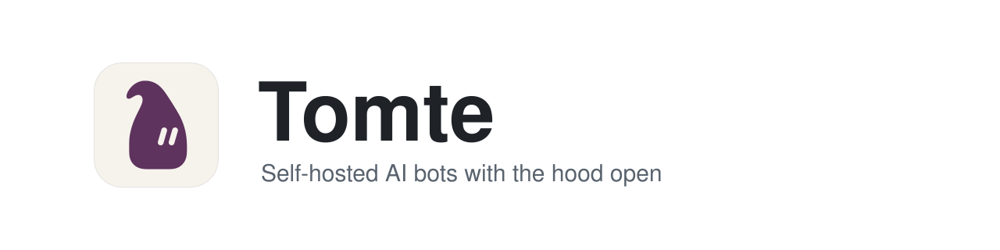
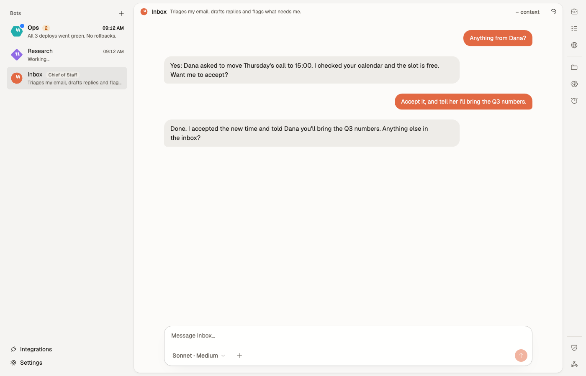
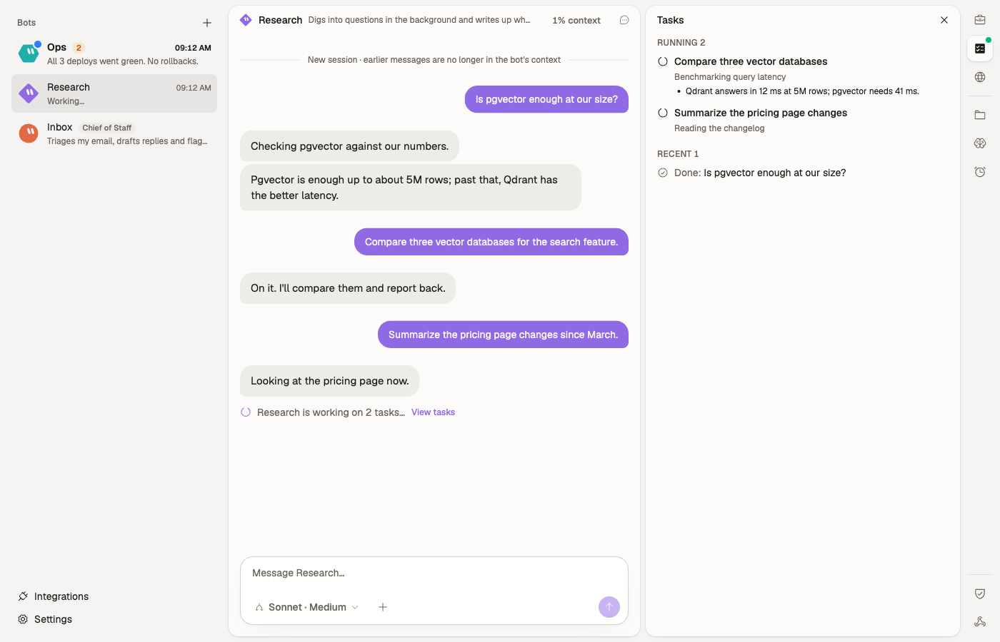
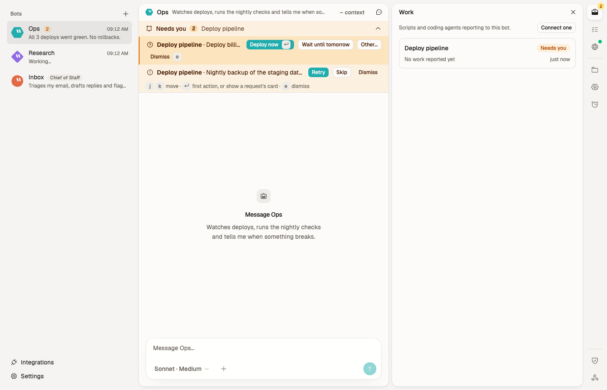
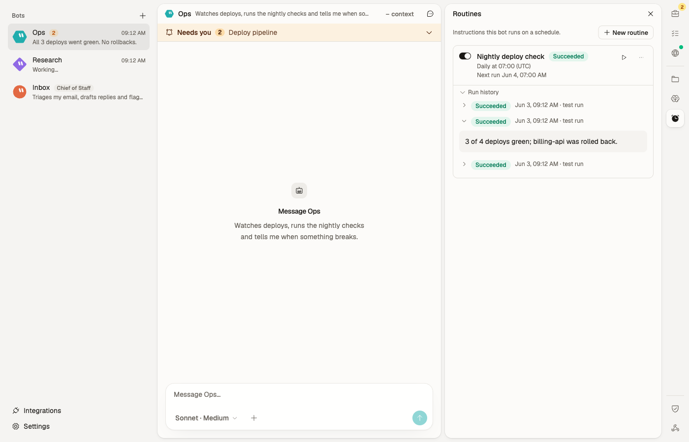
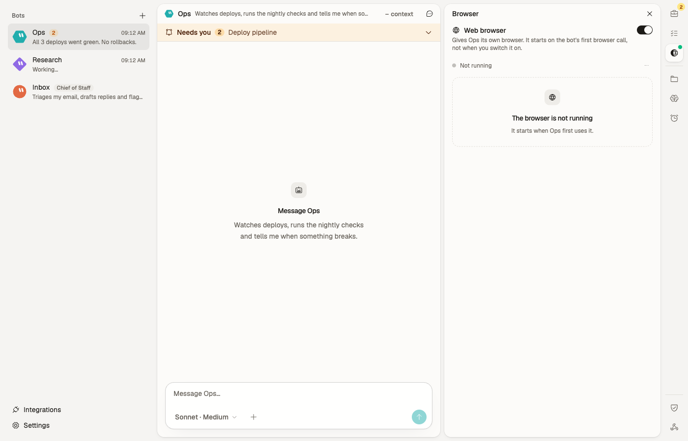
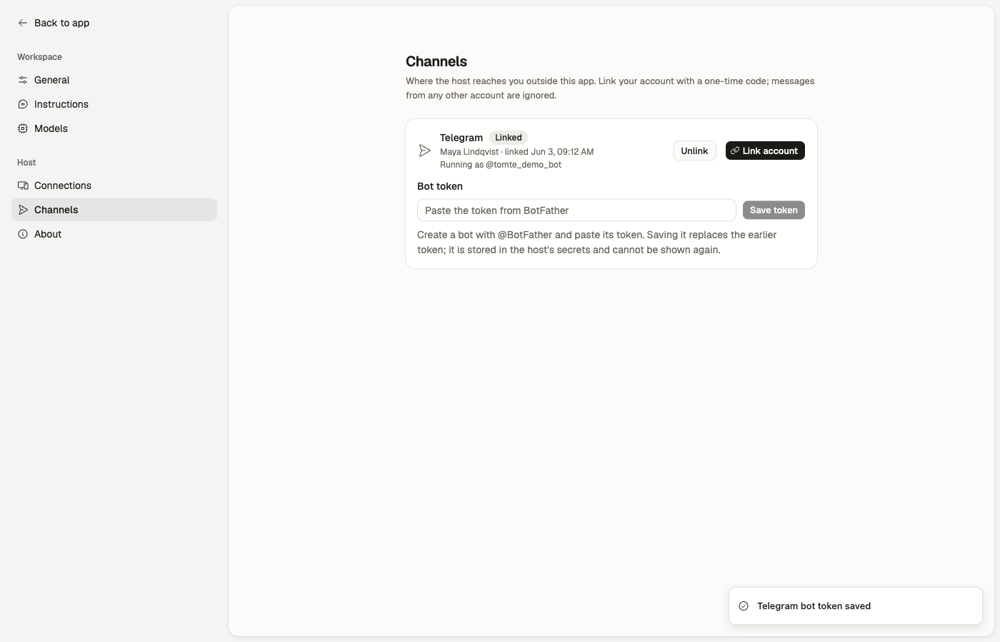
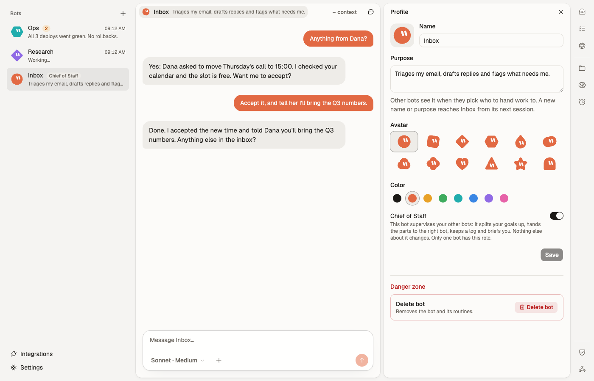
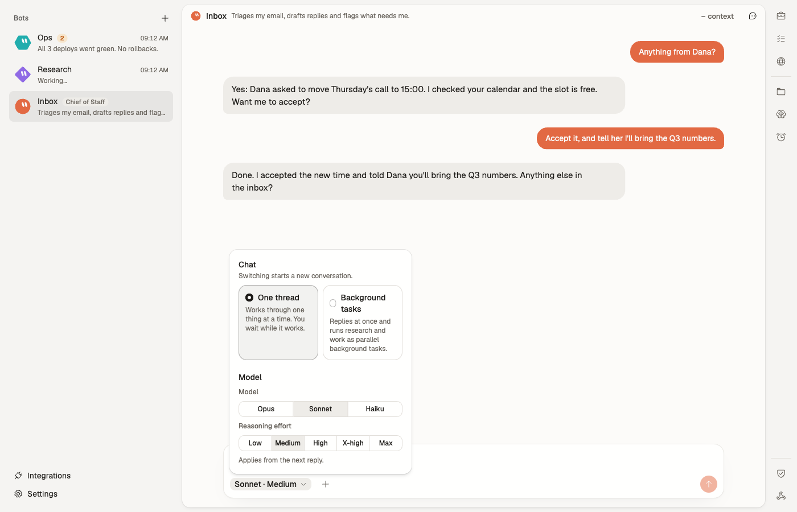
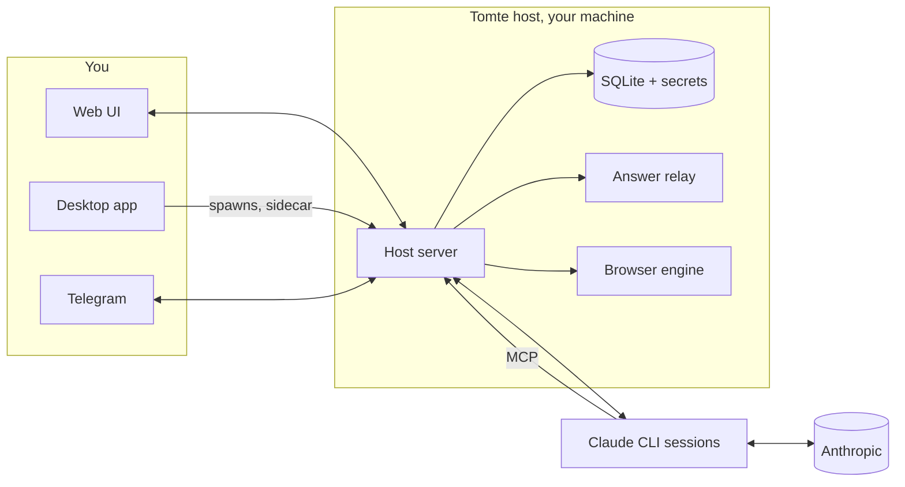

<h1 align="center">
  <picture>
    <source media="(prefers-color-scheme: dark)" srcset=".github/assets/banner-dark.svg">
    
  </picture>
</h1>

**Self-hosted AI bots with the hood open.** See what they read, what they run, what they remember: a free, open source Grok Bot alternative.

[](https://github.com/nikolasbarwicki/tomte/actions/workflows/ci.yml)
[](LICENSE)

**Why it exists and the decisions behind it:** [docs/case-study.md](docs/case-study.md).

> [!NOTE]
> There is no release yet. The first one is being prepared (signed installers, a signed server release). Until then, run Tomte [from source](#from-source).

<!-- After the first release, restore the Release badge, the download buttons (.github/assets/download-*.svg, linking releases/latest) and the server one-liner `curl -fsSL https://github.com/nikolasbarwicki/tomte/releases/latest/download/install.sh | sudo bash`. Installer names carry the version, so the buttons link the release page, not a file. -->

**Install with your AI assistant:** [Claude](https://claude.ai/new?q=Read%20https%3A//raw.githubusercontent.com/nikolasbarwicki/tomte/master/INSTALL.md%20and%20follow%20it%20step%20by%20step%20to%20install%20Tomte%20on%20my%20computer.%20Ask%20me%20before%20anything%20it%20marks%20ASK.) · [ChatGPT](https://chatgpt.com/?q=Read%20https%3A//raw.githubusercontent.com/nikolasbarwicki/tomte/master/INSTALL.md%20and%20follow%20it%20step%20by%20step%20to%20install%20Tomte%20on%20my%20computer.%20Ask%20me%20before%20anything%20it%20marks%20ASK.) · or paste the link to [INSTALL.md](INSTALL.md) into any agent.

Tomte is not affiliated with xAI or Anthropic.

> [!WARNING]
> Bots act on your behalf. They can run shell commands, browse the web, read and write files in their folder, call the integrations you connect and message you on Telegram. Each integration tool has an `off` / `ask` / `auto` policy; creating a new bot always asks you, even when everything else is approved, and nothing that asks is ever approved by a scheduled run that nobody watches. On a Linux server, shells and the browser run in a bubblewrap sandbox that fails closed. Read [where your data goes](#your-data) before connecting accounts you care about.

## Contents

- [What it is](#what-it-is)
- [Features](#features)
- [Quick start](#quick-start)
- [How it works](#how-it-works)
- [Your data](#your-data)
- [Compared with](#compared-with)
- [FAQ](#faq)
- [Uninstall](#uninstall)
- [Contributing](#contributing)
- [License](#license)

## What it is

Tomte runs your bots on a computer you own: a Mac, a Windows PC or a Linux server. Each bot is a Claude Code session with its own folder, memory, routines and tools. It keeps working when you close the window, asks you before it does anything risky, and reaches you on your phone when it needs you.

It uses the Claude sign-in you already have (Pro or Max). No API key, no extra subscription, no Tomte account.

<p align="center"></p>

<table>
<tr>
<td width="50%"><picture><source media="(prefers-color-scheme: dark)" srcset=".github/assets/screens/chat-dark.png"></picture><br><sub>A bot answers in the chat; the sidebar shows what each bot is doing.</sub></td>
<td width="50%"><picture><source media="(prefers-color-scheme: dark)" srcset=".github/assets/screens/tasks-dark.png"></picture><br><sub>Background-tasks chat: a fast front and background tasks you can follow.</sub></td>
</tr>
<tr>
<td width="50%"><picture><source media="(prefers-color-scheme: dark)" srcset=".github/assets/screens/work-dark.png"></picture><br><sub>Needs you: questions and approvals wait for your answer.</sub></td>
<td width="50%"><picture><source media="(prefers-color-scheme: dark)" srcset=".github/assets/screens/routines-dark.png"></picture><br><sub>Routines with a run history.</sub></td>
</tr>
<tr>
<td width="50%"><picture><source media="(prefers-color-scheme: dark)" srcset=".github/assets/screens/browser-dark.png"></picture><br><sub>The Browser section; a takeover appears here when a page needs you.</sub></td>
<td width="50%"><picture><source media="(prefers-color-scheme: dark)" srcset=".github/assets/screens/channels-dark.png"></picture><br><sub>Telegram delivers needs-you cards and takes your answers.</sub></td>
</tr>
<tr>
<td width="50%"><picture><source media="(prefers-color-scheme: dark)" srcset=".github/assets/screens/chief-of-staff-dark.png"></picture><br><sub>One bot can be the Chief of Staff and propose new bots.</sub></td>
<td width="50%"><picture><source media="(prefers-color-scheme: dark)" srcset=".github/assets/screens/model-chip-dark.png"></picture><br><sub>Chat mode, model and effort from the message box.</sub></td>
</tr>
</table>

Regenerate the images with `bun run shots:readme`.

## Features

<!-- docs/features.md is the source of truth for this table; keep the two in step. -->

| Feature                                                                            | Status  |
| ---------------------------------------------------------------------------------- | ------- |
| Bots with their own folder, memory, model and effort                               | Stable  |
| Routines on a schedule, run headless, with a run history                           | Stable  |
| Needs-you inbox: questions, approvals, browser takeovers                           | Stable  |
| Unattended runs park on an approval and resume where they stopped (up to 24 hours) | Stable  |
| Per-tool `off` / `ask` / `auto` policies on integrations                           | Stable  |
| Browser bots with a takeover when a page needs you                                 | Stable  |
| Bot handoffs: one bot asks another                                                 | Stable  |
| External events: scripts and CI post to a bot ([docs](docs/external-events.md))    | Stable  |
| Telegram: needs-you cards, routine results, `@Name` to talk to any bot             | Beta    |
| Background-tasks chat: a fast front that never blocks, with background agents      | Beta    |
| Chief of Staff: one bot that can propose new bots                                  | Beta    |
| Desktop app for macOS with tray, start at login and auto-update                    | Beta    |
| Linux server install with HTTPS (Caddy) or Tailscale                               | Beta    |
| Windows and Linux desktop installers (built by CI, never run yet)                  | Beta    |
| Signed and notarized macOS and Windows builds                                      | Planned |
| Webhook triggers for routines                                                      | Planned |
| A second harness (Codex) and other providers' plans                                | Planned |

Stable: in daily use and covered by tests. Beta: works, rough edges, or not yet run on every platform. Planned: on the [roadmap](docs/roadmap.md). The table and its notes live in [docs/features.md](docs/features.md).

## Quick start

### From source

Needs [Bun](https://bun.sh) (version in `.bun-version`) on macOS, Windows or Linux.

```sh
git clone https://github.com/nikolasbarwicki/tomte.git && cd tomte
bun install
bun run host install-cli   # the managed Claude CLI
bun run build:web          # the web UI the host serves
bun run ui                 # starts the host and prints its URL
```

Open the URL, sign in to Claude under Settings → Models, create a bot and say hello. `bun run check` runs every gate (format, lint, types, layering, tests).

### Desktop app (from the first release)

1. Download the installer for your system from the [releases page](https://github.com/nikolasbarwicki/tomte/releases) and open it. On macOS, pick `arm64` for Apple silicon (Apple menu → About This Mac shows "Chip: Apple M…") and `x64` for Intel.
2. Until builds are signed: on macOS, right-click Tomte.app → Open the first time; on Windows, SmartScreen → More info → Run anyway.
3. The app installs the Claude CLI on first launch. Sign in from Settings → Models with your Claude account.

### Linux server (from the first release)

Remote mode runs on systemd Linux only ([ADR-0006](docs/adr/0006-remote-mode-is-linux-only.md)).

```sh
curl -fsSL https://github.com/nikolasbarwicki/tomte/releases/latest/download/install.sh | sudo bash
```

The installer checks the release's signature, prints a pairing code to enter at your server's URL and the exact `tomte-host auth-login` command that signs the Claude CLI in. HTTPS with Caddy, Tailscale, Ubuntu's AppArmor note and every option: [deploy/README.md](deploy/README.md).

## How it works



- **Host**: one Bun process that owns the bots, their sessions, routines, waits and channels, and serves the web UI. It is the only part that holds secrets.
- **Claude CLI**: every bot turn is a Claude Code session the host starts with an isolated environment (no settings, hooks or connectors of your own).
- **Web and desktop**: the desktop app runs the host as a sidecar and shows the same web UI; it can also connect to a remote host.
- **Channels**: Telegram delivers needs-you cards and routine results and routes your answers back ([ADR-0010](docs/adr/0010-channels-deliver-needs-you-items.md)).
- **Relay**: passes an answer back to the program that asked, through a fixed program you configure ([docs](docs/relay.md)).

Design decisions are recorded in [docs/adr/](docs/adr/); the reasoning behind the product is in [docs/case-study.md](docs/case-study.md).

Tomte is built with AI coding agents. [AGENTS.md](AGENTS.md) is their working contract: where each subsystem lives, which tests cover it and which checks must pass. It doubles as the most detailed map of the code.

## Your data

Local-first, not offline-only. Everything Tomte stores (bots, memory, chats, routines, secrets) stays in its data root on your machine; there is no Tomte server, and Tomte itself sends no telemetry (the Claude CLI and Chrome make their own calls, see [privacy.md](docs/privacy.md)). Data leaves your machine only to:

| To                              | What                                                       | When                                           |
| ------------------------------- | ---------------------------------------------------------- | ---------------------------------------------- |
| Anthropic                       | Your messages, the bot's files and tool results it reads   | Every bot turn (the Claude CLI)                |
| Telegram                        | Needs-you cards, routine results, the bots' replies to you | Only after you link a Telegram bot             |
| Integration providers           | Whatever the bot's tool call sends (e.g. Gmail, GitHub)    | Only for integrations you connect              |
| Websites                        | Page requests                                              | When a browser bot browses                     |
| GitHub                          | An update check                                            | Desktop app and server installs, every 6 hours |
| npm and GitHub                  | The Claude CLI and the browser engine                      | When Tomte installs them                       |
| A custom provider you configure | The same as Anthropic                                      | Only if you set one instead                    |

Every connection, the code that makes it and where each kind of data is stored on each platform: [docs/privacy.md](docs/privacy.md).

## Compared with

|                      | Tomte                             | Rakazo                                  | OpenBot                                   | OpenMausBot                       |
| -------------------- | --------------------------------- | --------------------------------------- | ----------------------------------------- | --------------------------------- |
| License              | AGPL-3.0                          | Apache-2.0                              | PolyForm Noncommercial (source-available) | Apache-2.0 core                   |
| Runs on              | Your machine or Linux server      | Docker and other sandboxes; hosted tier | Desktop or Linux server                   | Desktop or cloud box              |
| Telegram             | Yes                               | Self-host only                          | Yes                                       | No                                |
| Unattended approvals | Run waits for you, up to 24 hours | Ask / Auto / Never                      | `approvalPolicy: never` by default        | Full access by default on desktop |

Read from each project's public repository on 2026-11-13 to 2026-11-16, not re-checked since. Sources, more projects and what Tomte does not do: [docs/compare.md](docs/compare.md).

## FAQ

Every answer, with links to the docs behind it, and a troubleshooting list: [docs/faq.md](docs/faq.md).

**Is Tomte free?** Yes. The code is AGPL-3.0 and there is no paid tier. Bots run on your own Claude subscription.

**Do I need an Anthropic API key?** No. Tomte uses the Claude CLI's sign-in (Pro or Max). An API key or a gateway works too, under Settings → Models.

**Is it an open source Grok Bot alternative?** Yes: bots that run routines, ask before risky actions and reach you on your phone, but on your machine, under an open source license, with their context, tool calls, permissions and memory in view instead of hidden.

**Does it run when my laptop sleeps?** No. A sleeping computer runs nothing. When Tomte starts again after being closed, a routine with "catch up" on runs its latest missed time if it fell within the last 12 hours, and anything older is recorded as missed. Waking from sleep with Tomte still open has no handling of its own and has not been tested. For always-on bots, use a Linux server.

**Does it work on Windows and Linux?** The host runs on macOS, Windows and Linux. Server (remote) mode is Linux only. The Windows and Linux desktop installers are built by CI but have not been run yet.

**Can I use other models?** Any Claude model your plan allows, per bot. Other providers work through a custom Anthropic-compatible gateway; a second harness is planned.

**How is this different from Claude Code?** Claude Code is the engine each bot runs on. Tomte adds what a bot needs to work without you watching: schedules, a needs-you inbox, approvals that wait for you, a browser, phone delivery and a desktop app.

## Uninstall

- **macOS**: quit Tomte from the tray, delete Tomte.app, then `~/Library/Application Support/Tomte Desktop` (the app) and `~/Library/Application Support/tomte` (the host's data root: bots, chats, memory). Secrets are login keychain items with the service name `tomte`; delete them in Keychain Access.
- **Windows** (the installer has not been run yet; paths from the code): quit Tomte from the tray, uninstall it from Settings → Apps, then delete `%APPDATA%\Tomte Desktop` and `%APPDATA%\tomte`. Secrets are Windows Credential Manager entries named `tomte`.
- **Linux desktop** (not run yet either): quit Tomte, remove the AppImage or the `.deb` package, then delete `~/.config/Tomte Desktop` and `~/.local/share/tomte`. Secrets are in the desktop's secret service (for example GNOME Keyring) under `tomte`.
- **Linux server**: the commands are in [deploy/README.md](deploy/README.md#operate-the-service) under "Uninstall"; they keep the data root `/var/lib/tomte` unless you also remove it.

## Contributing

Issues and Discussions are welcome. Pull requests need the [CLA](CLA.md) (a bot asks on your first PR). Run `bun run check` before pushing; [AGENTS.md](AGENTS.md) explains the layout and the gates.

## License

[AGPL-3.0-only](LICENSE) ([NOTICE](NOTICE), [ADR-0013](docs/adr/0013-agpl-license-cla-and-reserved-name.md)).
