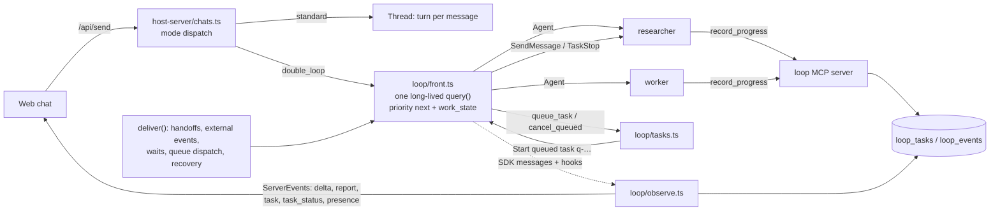

# Double-loop chat mode: implementation prompt

Status: ready-for-agent

## Prompt

You are adding a second way to chat with a bot to Tomte: the **double-loop chat mode**, ported from the working prototype in `../double-loop/v3` (design: `../double-loop/docs/double-loop-design.md` § "v3 as built", plan: `../double-loop/docs/v3-plan.md`). The user picks the mode per bot with a toggle. The current turn-based chat ("standard") stays the default and stays unchanged.

In double-loop mode one long-lived, fast **front** session answers every message within seconds and never blocks the composer. Heavy work runs in **background agents** (Claude Code background subagents) that the front starts, steers (`SendMessage`), queues and stops (`TaskStop`). Several agents run in parallel. Each agent's result is posted to the chat as the bot's own message. The front then adds one line about what is still running.

Read `AGENTS.md`, ADR-0003 (host feature modules), ADR-0004 (web feature modules and host store) and ADR-0002 (handoffs) before you start. Follow the plan below milestone by milestone. Each milestone ends green on `bun run check`. Where this spec marks a decision as **recommended**, take it unless the code proves it wrong; record each decision you take in the ADR (M0).

## What the prototype does (port these, not the scaffolding)

| v3 file                                                                                                    | Owns                                                                                                                                                                                                                                                                                                                                                                                                                                                                                      | Port to Tomte                                                           |
| ---------------------------------------------------------------------------------------------------------- | ----------------------------------------------------------------------------------------------------------------------------------------------------------------------------------------------------------------------------------------------------------------------------------------------------------------------------------------------------------------------------------------------------------------------------------------------------------------------------------------- | ----------------------------------------------------------------------- |
| `src/front.ts`                                                                                             | `FRONT_PROMPT`; `workState()` (the app-written `<work_state>` block appended to every message the front receives); `progressCheck()`; `Front` (one `query()` over an `InputQueue`, messages pushed with `priority: "next"`, `origin: {kind:"human"}` or `isSynthetic: true`); `recover()` after restart                                                                                                                                                                                   | Yes: prompt, work state, input semantics, recovery                      |
| `src/agents.ts`                                                                                            | `researcher` (WebSearch/WebFetch) and `worker` (files + sandboxed Bash) `AgentDefinition`s with `background: true`; `PROGRESS_RULES`, `RESULT_RULES`; in-process MCP `record_progress`, `queue_task`, `cancel_queued`; `ProgressAttribution` (PreToolUse hook notes `agent_id → tool_use_id`, so findings are attributed by the app, not the agent)                                                                                                                                       | Yes; agent tool sets change (below)                                     |
| `src/observe.ts`                                                                                           | SDK messages and hooks → log events: `task_started` → task started/resumed; `task_progress.summary` → live status line (not persisted); `task_notification` → done/failed/cancelled; `SubagentStop.last_assistant_message` (fallback: `lastAssistantText(agent_transcript_path)`) → report, waits up to 5s for the pair; `SendMessage` tool use/result → steer sent/failed; `TaskStop` on an interrupted task → cancelled; front `stream_event` text → assistant message with `latencyMs` | Yes                                                                     |
| `src/tasks.ts`                                                                                             | Task registry folded from the log (`foldTasks`), app queue (`after: taskId \| null`), `due()`/`pump()` dispatching "Start queued task q-…" to the front, claim by `name`, 120s re-dispatch, fail after 2                                                                                                                                                                                                                                                                                  | Yes                                                                     |
| `src/log.ts`                                                                                               | Event union: `user`, `assistant{source: front\|report, taskId?, latencyMs?}`, `session`, `task{status: queued\|started\|resumed\|interrupted\|cancelled\|done\|failed, agentType, model, effort, after, queuedId}`, `activity{search\|open\|tool}`, `progress{phase, finding, next}`, `steer{sent\|failed}`                                                                                                                                                                               | Yes, as SQLite rows (below)                                             |
| `src/server.ts`, `public/index.html`                                                                       | HTTP/SSE, devtools page                                                                                                                                                                                                                                                                                                                                                                                                                                                                   | No: Tomte's routes, event stream and web UI replace them                |
| `assertSubscriptionAuth`, `authProblem`, `CLAUDE_CODE_OAUTH_TOKEN`, `settingSources: []`, own `CLAUDE_DIR` | Subscription-only guard                                                                                                                                                                                                                                                                                                                                                                                                                                                                   | No: Tomte's `ClaudeAccess` already owns sign-in and the CLI environment |
| `eval/routing.ts`                                                                                          | 31 labelled routing cases, ≥90% gate                                                                                                                                                                                                                                                                                                                                                                                                                                                      | Yes, as a manual script outside `bun run check` (needs a real model)    |

Evidence the prototype works (from `../double-loop/v3/runs/`; the design doc's "not yet run" note is stale):

- Front replies arrive in 0.7–3.4s with an agent running (`probe-p1`).
- A steer during research changed the agent's scope and the next `record_progress` reflected it (`probe-p2`).
- Three agents ran in parallel and posted results (`probe-p3`).
- `kill -9` with two agents running, then resume (`probe-p4`).
- The worker's file tools were refused outside the workspace and its sandbox blocked network and home writes (`m5`).

`probe-p1` also shows that tasks can fail to start and that a stop can miss its id. Port the eval and run it.

Front defaults that worked in v3: `claude-haiku-5-5` with `thinking: {type: "disabled"}`; other models at `effort: "low"`. Agent defaults: `claude-sonnet-5-5` at `medium` effort, `maxTurns` 60 (researcher) and 80 (worker), `MAX_PARALLEL` 3 via `CLAUDE_CODE_MAX_CONCURRENT_SUBAGENTS`, `CLAUDE_CODE_RESUME_INTERRUPTED_TURN=1`, `agentProgressSummaries: true`, `includePartialMessages: true`. Unprompted progress pings are off by default (Grok Bot comparison, design doc § "Chat mechanics"). Do not port them in the first cut.

## How Tomte chats today (what you are plugging into)

- `packages/host/src/bots/thread.ts` `Thread`: one SDK `query()` per bot over an `Inbox`. `send()` throws while `busy`. It pushes one message and iterates until `result`. `open()` builds options from `claudeHarness.launch()` (`harness/index.ts`: preset `claude_code` system prompt + append, `permissionMode: "default"`, `strictMcpConfig`, `settingSources: ["user"]`, `--mcp-config` temp file with host HTTP MCP servers, `disallowedTools`, sandbox), plus `canUseTool`, the in-process `host` MCP server (`ask_user`, `remember`, `rewrite_memory`), `model`, `env`. `close()` on error, on `idleMs` (10 min, `host-server/threads.ts:25`) and on integration token expiry.
- `packages/host/src/host-server/chats.ts` `Chat`: `busy` flag, `inbox`, `history`, `pending` asks. `OpenChat.send()` → `answered | queued | start | refused`. `drain()` batches queued entries into one turn. `deliver(botId, text)` is the single injection point for handoff results, external events and browser waits. `reconfigure()` closes the thread (or sets `configStale`). `turn()` maps SDK messages to `ServerEvent`s (`text_start`, `delta`, `tool`, `done`, `error`, `context`, `compacted`).
- Transcripts are not stored: `host-server/transcript.ts` `replay()` rebuilds them from the CLI's session file (`getSessionMessages`), skipping `parent_tool_use_id` messages and splitting wrapped external events.
- Contract: `ServerEvent` and `Bot`/`BotSummary` in `packages/contract/src/events.ts`; `DEFAULT_MODEL`/`DEFAULT_EFFORT` and `PublicHostInfo.capabilities` in `api.ts`. `/api/send` schema is local to `host-server/api/chat.ts`.
- Per-bot settings live in `<dataRoot>/bots/<id>/bot.json` (`StoredBot` in `bots/index.ts`). New fields need a default there, and `save()` must preserve them as it does `browser`. The headed-browser toggle is the pattern to copy end to end: `features/browser/browser-panel.tsx` (`DropdownMenuCheckboxItem`) → `features/browser/api.ts` → `/api/bots/browser/headed` in `api/bots.ts` → `bot.json` → `chats.announceBots()`.
- SQLite migrations: append `SCHEMA_V14` in `platform/db.ts` (`PRAGMA user_version`).
- Web: `host/state.ts` (`applyEvent`, `chat.busy`), `host/transcript.ts` (`Item` union, `reduce`), `features/chat/{chat,composer,transcript}.tsx`, `features/bots/bot-panel.tsx` (the panel's sections), `app/routes/bot.lazy.tsx` (composes features through slots).
- Tests: `testing/fake-claude.ts` (stream-json control protocol; emits only `control_response` and `result`, scripts only `host` MCP tools), `testing/test-host.ts` (`startHandoffHost`), browser smokes via `scripts/smoke-kit.ts`.
- Installed `@anthropic-ai/claude-agent-sdk` is 0.3.318; v3 ran on 0.3.322.

## Decisions

1. **Toggle scope: per bot (recommended).** Add `chatMode: "standard" | "double_loop"` to `Bot` (default `"standard"`), carried on `BotSummary`. A global default would also need a new-bot field; skip it. Rejected: a global `HostConfig` flag. It forces one mode on every bot and cannot be flipped from the UI.
2. **Switching starts a new session (recommended).** The two modes use different system prompts, agent definitions and session shapes, so continuing one mode's CLI session in the other mixes them. Switching calls `newSession`. It is refused (409) while double-loop agents are running or queued; the UI says "stop the running tasks first".
3. **Durable task log in SQLite (recommended).** Tables `loop_tasks` and `loop_events`, keyed by bot and session: task lifecycle, progress, activity, steer and **reports**. Reports never enter the front's CLI session (v3 keeps them out of the front's context on purpose), so `replay()` cannot rebuild them from the session file. In double-loop mode, replay merges the session file with `loop_events` by timestamp. Alternative: JSONL per bot like v3. Rejected: the host already has a migration mechanism and `bot_activity`/`handoffs` precedents.
4. **Replay strips app-written blocks.** User messages in the front session end with `<work_state>…</work_state>`; synthetic app messages ("Start queued task…", "The app restarted…", task notifications) are `isSynthetic`. Replay drops both, so the transcript shows exactly what the user typed and what the bot said.
5. **Front tool set.** `Agent`, `SendMessage`, `TaskStop`, `mcp__loop__queue_task`, `mcp__loop__cancel_queued`, plus `mcp__host__remember`/`rewrite_memory` so standing rules still land in memory. The front never gets `ask_user`: it asks in chat, because a blocking ask would stall the never-blocking front. As in v3, the main thread runs as a `front` agent (`agent: "front"`) whose tool list is that set. The session's `tools` must hold every agent's tools, because subagents only see what the session has (v3 probe P3).
6. **Agent types (recommended).**
   - `researcher`: WebSearch, WebFetch, `record_progress`.
   - `worker`: the bot's own capabilities: file tools in the bot's workspace, Bash under the bot's isolation profile, the bot's integration MCP tools, `mcp__host__ask_user`, `record_progress`.
   - Browser tools stay off agents in the first cut. The browser session is one per bot (GLOSSARY), and parallel agents would fight over its tabs. Revisit with a lock later.
   - Handoff tools (`mcp__bots__*`) stay on the front only, so a handoff result comes back through `deliver()` into the front.
7. **Permissions keep Tomte's rules.** Reuse `Thread.canUseTool` and the `HostDelegate`. A background agent's approval or `ask_user` raises the normal approve/ask card, which is a needs-you item. That agent waits; the front and the other agents keep going. Do not port v3's `permissionMode: "dontAsk"`: a human is present here. Keep v3's PreToolUse path guard as defence in depth for the worker.
8. **`deliver()` in double-loop mode** pushes a synthetic message (`isSynthetic: true`, `priority: "next"`) into the front instead of queueing a turn. This applies to handoff results, external events and browser waits. Routine prompts no longer go to the front: a double-loop bot's routine runs go headless in a session of their own (ADR-0011, "Routine runs").
9. **No composer queue.** In double-loop mode `/api/send` always answers `outcome: "sent"`. `queued`/`dequeued` and `/api/send/cancel` do not apply. Answers to needs-you items (`eventId`) keep their current path: a linked ask is answered directly, otherwise the message goes to the front.
10. **Presence instead of "is working…" per turn.** `BotSummary.status` is `working` while the front's turn or any agent runs. The transcript shows one presence line: "typing…" while the front streams, "working…" while agents run. Front text still streams through `text_start`/`delta`. Reports appear whole.

## Architecture

New host feature module `packages/host/src/loop/` (add `loop` to `MODULES` in `.dependency-cruiser.cjs`; public surface `index.ts` only), wired in the composition root `host-server/index.ts`:

- `front.ts`: `FrontSession`. It is shaped like `Thread`, but a pump consumes the query iterator for the session's whole life instead of per turn. Options come from `claudeHarness.launch()` plus the overrides in decision 5, `agents`, `agentProgressSummaries`, the env vars above, and hooks from `observe.ts`. Front model and effort are applied as in `Thread.open()`.
- `agents.ts`: agent definitions and prompts (port `PROGRESS_RULES`, `RESULT_RULES`, researcher and worker prompts; append bot persona and memory to the worker), `ProgressAttribution`, the `loop` in-process MCP server.
- `observe.ts`: port of v3 `Observer`. It writes to the store and emits `ServerEvent`s through a callback the chat gives it.
- `tasks.ts`: port of v3 `Tasks` over the store.
- `work-state.ts`: `workState()` from v3, pure and unit-tested.
- `store.ts`: SQLite access for `loop_tasks` and `loop_events`.

## Plan

| #   | Scope                                                                                                                                                                                                                                                                                                                                                    | Done when                                                                                                                                |
| --- | -------------------------------------------------------------------------------------------------------------------------------------------------------------------------------------------------------------------------------------------------------------------------------------------------------------------------------------------------------- | ---------------------------------------------------------------------------------------------------------------------------------------- |
| M0  | ADR-0011 "double-loop chat mode" (decisions above, links to the v3 docs); GLOSSARY entries: **Chat mode**, **Front session**, **Background task**, **Work state**, **Finding**, **Steer**. Bump the SDK to ≥0.3.322 if `task_started`/`task_notification`/`SubagentStop.last_assistant_message`/`agentProgressSummaries` differ in 0.3.318's `sdk.d.ts`. | ADR and glossary merged; `bun run check` green                                                                                           |
| M1  | Contract and toggle: `Bot.chatMode` + `StoredBot` default + `save()` preservation; `POST /api/bots/chat-mode` (409 while tasks run; calls `newSession` and `announceBots`); UI toggle in the chat app bar or composer settings menu (follow the headed-browser `DropdownMenuCheckboxItem` pattern) with a confirm that a new conversation starts.        | Toggling persists across host restarts; `stored-bot.test.ts` covers the default for an old `bot.json`                                    |
| M2  | Front session without agents: `loop/front.ts`, mode dispatch in `chats.ts` (`send`, `deliver`, `reconfigure`, `drop`, `newSession`, `replayOpen`, `isWorking`), never-blocking `/api/send`, presence, replay with `<work_state>`/synthetic stripping.                                                                                                    | A double-loop bot answers two messages sent 1s apart without `queued`; the reloaded transcript shows no `<work_state>`                   |
| M3  | One researcher end to end: `agents.ts`, `observe.ts`, `store.ts` (`SCHEMA_V14`), `record_progress` attribution, report posting, new `ServerEvent`s (`task`, `task_status` (ephemeral, not in history), `report{taskId, text}`), web `host/transcript.ts` items and rendering (report as a normal bot message; tooltip names the task).                   | "research X" starts an agent; the status line moves; the report is posted once and survives a reload                                     |
| M4  | Parallel, steer, cancel, queue: `tasks.ts`, `queue_task`/`cancel_queued`, work state with findings, steer events, a **Tasks** section of the bot panel (`features/tasks`) (running with status line and findings, queued, recent; composed through a slot in `app/routes/bot.lazy.tsx`, no cross-feature import).                                        | A scripted test starts two tasks, steers one, cancels one, queues "after that" and the queued task starts when its blocker ends          |
| M5  | Lifecycle and recovery: idle close and `configStale` never close a front with running agents (defer until idle); integration token expiry the same; on host start, mark running tasks `interrupted` and send v3's "The app restarted…" message when the bot's chat opens; `TaskStop` on an interrupted task cancels it.                                  | Host restart with two running agents: both resume under the same ids and report                                                          |
| M6  | Worker and isolation: worker tools from the bot's integrations and isolation profile; v3 path guard hook; decision 7 approval cards from agents surface as needs-you. Fix the `TaskStop` conflict (Risks).                                                                                                                                               | A worker writes in the bot workspace and is refused outside it; a Bash approval from an agent shows a card while the front still answers |
| M7  | Tests, eval, smoke, docs: extend `fake-claude.ts`; port `eval/routing.ts` to `scripts/eval-loop-routing.ts` (manual, real model, exits non-zero under 90%); a `smoke:loop-ui` browser smoke on the fake CLI; `AGENTS.md` section; raise coverage baselines if they rose.                                                                                 | `bun run check` and `bun run smoke:ui` green; eval run recorded in the ADR                                                               |

## Risks the code already shows

- **`TaskStop` is a shell tool here.** `harness/index.ts` `SHELL_TOOLS` contains `TaskStop`, and `isolation.shell === "disabled"` puts it in `disallowedTools` for the whole session. An isolated double-loop bot could then never stop an agent. Remove `TaskStop` from the session-wide deny list in double-loop mode. Add a `PreToolUse` hook that refuses `TaskStop` when its `task_id` is not a background agent the store knows. `shell-isolation.test.ts:153` pins the current list; update it as a contract test.
- **Anything that closes the front kills every agent.** That covers `idleMs`, `reconfigure()` (fired for every bot on integration and bot changes, `host-server/index.ts:194,215`), token expiry and errors in `send()`. `Thread.send` closes on any error. The front's pump must not.
- **Busy semantics.** `Chat.busy`, `drain()` and the `headlessRuns` guard assume one turn at a time. Keep them for standard bots. A double-loop chat bypasses `busy` and `inbox` entirely; do not overload them.
- **Context growth.** The front keeps the whole chat. Reports stay out of it, as in v3, and auto-compaction handles the rest; `compacted` events already render.
- **Subscription limits.** Parallel agents share the user's 5-hour and weekly limits. Surface `rate_limit_event` (status, utilization, reset) next to the context meter when the bot is in double-loop mode.
- **The fake CLI cannot drive this yet.** It emits no `assistant`, `stream_event` or `system` task messages and sends no `hook_callback` control requests. M7 extends it with a scripted file (for example `loop.json`: a list of messages and hook calls to emit per user message) before the M3–M5 tests can run; schedule that work alongside M3, not after.
- **CLI-version drift.** Background tool filtering, task events and `SendMessage` resume changed across recent Claude Code versions (v3 plan § Risks). The managed CLI version is pinned in `harness/cli.ts`; rerun the routing eval and a manual restart test when bumping it.

## Non-goals

- v3's devtools page, trace rows and SDK cost estimate.
- Unprompted progress updates (`UNPROMPTED_UPDATES`).
- Browser tools on background agents.
- (Done later, ADR-0011 "Routine runs": double-loop routine runs are headless and park.)
- Multiple front sessions per bot.

## Verification

- Unit: `workState()`, `progressCheck()` if ported, `foldTasks`, queue `due()` ordering and the dispatch timeout, `ProgressAttribution`, replay stripping, `StoredBot` default.
- Host integration (fake CLI, `startHandoffHost`): never-blocking send, report persistence across reload, steer/cancel/queue, restart recovery, `TaskStop` refusal for non-agent ids, chat-mode switch refused while tasks run.
- Web: `host/state.test.ts` and `host/transcript.ts` reducers for `task`, `task_status`, `report` and presence.
- Manual with the real CLI: the v3 drive scenario (start two, status question, steer, "after that", cancel) and a host restart with agents running; record timings in the ADR.
