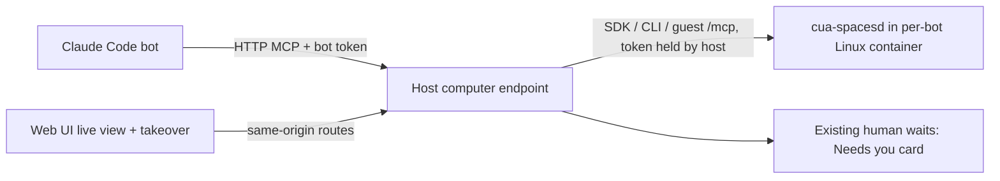

# Computer use for tomte (via Cua): research and recommendation

Researched 2026-11-05/06. Status: research only, no decision yet; next step is the spike in Part B.

- **Part A** (sections 0–9 and "Implications"): facts from primary sources, each with its URL. Anything not directly observed is marked [UNVERIFIED].
- **Part B** (sections 10–16): analysis for tomte — capabilities, proposed design, initial scope, spike, pros/cons, recommendations. Inferences there are marked [INFERENCE].

# Part A: Cua facts

## 0. Headline: the brief's premise is out of date

The brief asks about the Computer SDK, Agent SDK, computer-server and Cua Cloud. All four are gone or no longer maintained:

- **Cua Cloud and Fleets ended on 18 Oct 2026.** `on="cloud"` now fails with "Cua Cloud has ended…". Source: https://cua.ai/docs/cua-sdk/guides/cua-cloud-ended
- **Deprecated and unmaintained** (last releases): `cua-computer` 0.5.19, `cua-computer-server` 0.3.46, `cua-agent` 0.10.1 (all on PyPI) and `cuabot` 1.0.14 (npm). The docs say of cuabot: "known security issues… Do not run it." Sources: https://cua.ai/docs/cua-sdk/guides/cua-cloud-ended and https://github.com/trycua/cua (README, "Deprecated packages")
- These replace them: **Cua Driver** (Rust; MCP and CLI; drives native apps), **cua SDK + `cua` CLI** (Rust core with Python, TS and Rust bindings; sandboxes), **cua-spacesd** (in-guest daemon on port 3211, gRPC) and **Cua Spaces** (desktop app). Source: https://github.com/trycua/cua

## 1. What Cua is

| Component                 | What it is                                                                                                                                                                                                                         | License                                                                           | Source                                                                              |
| ------------------------- | ---------------------------------------------------------------------------------------------------------------------------------------------------------------------------------------------------------------------------------- | --------------------------------------------------------------------------------- | ----------------------------------------------------------------------------------- |
| Cua Driver (`cua-driver`) | Background computer-use driver for macOS, Windows and Linux. Speaks MCP over stdio. Also has a CLI (`cua-driver call <tool>`) and an SDK (`cua_driver` for Python, `@trycua/cua-driver` for TS, via UniFFI, in-process).           | MIT (the optional `cua-perception` extension is AGPL)                             | https://raw.githubusercontent.com/trycua/cua/main/libs/cua-driver/README.md         |
| cua SDK + `cua` CLI       | Sandboxes (containers, VMs, microVMs) locally, in your own AWS/GCP/Hetzner/Modal account, or on E2B/Daytona. Packages: Python `pip install cua`, TS `@trycua/cua`, Rust `cua-sdk`. Swift and Kotlin bindings are not yet released. | MIT                                                                               | https://github.com/trycua/cua                                                       |
| cua-spacesd               | Daemon inside the guest on port 3211: gRPC/gRPC-Web, `/mcp` (Streamable HTTP), `/viewer/`, `/files`, and media over H.264/Opus (QUIC on 3212). It replaces computer-server (port 8000) and is **not wire-compatible** with it.     | FSL-1.1-MIT (becomes MIT 2 years after each release; no competing hosted service) | https://raw.githubusercontent.com/trycua/cua/main/libs/cua-spacesd/README.md        |
| Cua Spaces                | macOS app (Tauri on Linux/Windows) that gives agents full desktops. Has multiplayer cursors, "teleport" of signed-in apps, and a Keyvault. Free for individuals. Pro is $18/mo ($180/yr); Teams is $30/seat/mo.                    | FSL-1.1-MIT                                                                       | https://github.com/trycua/cua, https://cua.ai/pricing                               |
| Lume                      | CLI, local HTTP API (`lume serve`, port 7777) and MCP for macOS and Linux VMs on Apple Silicon, using Virtualization.framework.                                                                                                    | MIT                                                                               | https://cua.ai/docs/lume/quickstart, https://cua.ai/docs/lume/reference/http-api.md |
| Lumier                    | Docker-compatible interface for Lume VMs.                                                                                                                                                                                          | MIT                                                                               | https://github.com/trycua/cua                                                       |
| Cua Bench, CUA-S1         | Benchmarks and RL tooling; small specialized "System 1" models. Not relevant to tomte.                                                                                                                                             | MIT (code)                                                                        | https://github.com/trycua/cua                                                       |

**Activity and maturity** (GitHub API, 2026-11-05):

- 31,794 stars, 2,363 forks, ~1,400 open issues. Primary language is Rust. Last push was 2026-11-05. Source: https://github.com/trycua/cua (via `gh api repos/trycua/cua`)
- Release cadence is very high and all versions are still 0.x:
  - cua-spaces ships stable or beta releases almost daily (v0.20.0 on 2026-11-03, v0.21.0-beta.7 on 11-05).
  - cua-spacesd v0.11.0 on 11-05; cua-sdk v0.10.1 on 11-03.
  - cua-driver-rs: stable v0.33.1 on 2026-10-03, nightlies at 0.38.1 (11-04). About 26 minor versions between July and October 2026.
  - lume v0.6.0 on 2026-10-01.
  - Source: `gh api repos/trycua/cua/releases`, https://github.com/trycua/cua/releases
- Interpretation: there is heavy churn and frequent breaking re-architectures (computer-server → spacesd within months). Pin exact versions.

## 2. Sandbox / VM options

| Option           | Details                                                                                                                                                                                                                                                                                                                                                    | Source                                                                                                       |
| ---------------- | ---------------------------------------------------------------------------------------------------------------------------------------------------------------------------------------------------------------------------------------------------------------------------------------------------------------------------------------------------------- | ------------------------------------------------------------------------------------------------------------ |
| macOS VM (Lume)  | Needs an Apple Silicon Mac on macOS 13+, **8 GB free memory and ~50 GB free disk**. `lume create macos-tahoe --ipsw latest --unattended tahoe` creates user `lume`/`lume` with SSH on. A macOS Space needs about 50 GB.                                                                                                                                    | https://cua.ai/docs/lume/quickstart, https://cua.ai/docs/spaces/guides/troubleshoot.md                       |
| macOS 2-VM limit | "Apple allows two macOS VMs at a time on one Mac" (error `vm_limit`).                                                                                                                                                                                                                                                                                      | https://cua.ai/docs/spaces/guides/troubleshoot.md                                                            |
| macOS image      | `ghcr.io/trycua/macos:15` (Sequoia). It **still ships legacy cua-computer-server, not cua-spacesd**. Exec, screenshots and view go over SSH and VNC instead.                                                                                                                                                                                               | https://cua.ai/docs/cua-sdk/reference/os-image-catalog.md                                                    |
| Linux container  | `ghcr.io/trycua/linux:24.04`: XFCE on Xvfb, cua-spacesd on 3211, HTML5 viewer at `/viewer/`. Runs on Docker or Podman, using gVisor if installed, else runc. With `kind="vm"` it runs under QEMU. On a Mac with no container engine, cua boots one shared Linux VM (up to 75% of RAM, capped at 32 GiB, and 4 CPUs by default; it stops after 120 s idle). | https://cua.ai/docs/cua-sdk/guides/local-runtimes, https://cua.ai/docs/cua-sdk/reference/os-image-catalog.md |
| Windows          | `Image.windows()` is amd64. It runs under **slow TCG emulation on Apple Silicon**. Windows 11 ARM works on QEMU but needs swtpm, AAVMF firmware and a manual NetKVM driver install. No Windows license is included.                                                                                                                                        | https://cua.ai/docs/cua-sdk/guides/local-runtimes, https://cua.ai/docs/cua-sdk/reference/os-image-catalog.md |
| Windows Sandbox  | Not found in current docs. [UNVERIFIED] Older Cua releases supported it; current docs list QEMU and Hyper-V runtimes (https://cua.ai/docs/llms.txt, "Runtimes and configuration").                                                                                                                                                                         |                                                                                                              |
| Cua Cloud        | **Ended 2026-10-18.** No hosted pricing. "Your own cloud" bills you directly at the cloud provider.                                                                                                                                                                                                                                                        | https://cua.ai/docs/cua-sdk/guides/cua-cloud-ended                                                           |
| Resource sizing  | The default profile is 2 vCPU / 4 GiB. `rollout` is 1 vCPU / 1 GiB with no desktop. `--ready-timeout` defaults to 600 s plus up to 120 s for spacesd. Pools hand out a ready sandbox in about 0.1 s. Forks restore memory in about 1 s or less.                                                                                                            | https://cua.ai/docs/cua-cli/reference/cli/sandboxes.md                                                       |
| Startup time     | A cold macOS VM start is slow on first use: "first macOS Space unpacks a large image and can run out of time". Exact cold-boot seconds are [UNVERIFIED].                                                                                                                                                                                                   | https://cua.ai/docs/spaces/guides/troubleshoot.md                                                            |

## 3. Interfaces (TypeScript and non-Python use)

- **TypeScript SDK exists:** `@trycua/cua` is a "thin, generated binding over the Rust cua-sdk crate".
  - It covers sandboxes, typed calls to spacesd plus `callJson` for every `cua.env.v1` RPC, media sessions, and Spaces.
  - Native payloads ship as optional per-platform packages (`@trycua/cua-darwin-arm64`, `-linux-x64-gnu`, …).
  - A browser and webview subset is available via `@trycua/cua/browser` and `@trycua/cua/spaces/transport`.
  - Source: https://raw.githubusercontent.com/trycua/cua/main/libs/cua/typescript/README.md
- **Parity:** the README says there is "the same API in Python, TypeScript and Rust". Source: https://github.com/trycua/cua. Whether Bun can load the UniFFI native addon is [UNVERIFIED]; the README only states Node.
- **Driver SDK for TS:** `@trycua/cua-driver` runs in-process through UniFFI and needs no daemon. Source: https://raw.githubusercontent.com/trycua/cua/main/libs/cua-driver/README.md
- **Protocol:** cua-spacesd speaks gRPC and gRPC-Web on 3211 (`cua.env.v1`).
  - Services: System, Process, Filesystem, Computer, Windows, Accessibility, Driver, Stream, Presence, Teleport, Tunnel.
  - HTTP: unauthenticated `GET /health`, HMAC-signed `/files`, and Streamable-HTTP MCP at `/mcp`.
  - Source: https://raw.githubusercontent.com/trycua/cua/main/libs/cua-spacesd/README.md
  - Legacy computer-server (HTTP and WebSocket on 8000) is deprecated. Source: https://cua.ai/docs/cua-sdk/guides/cua-cloud-ended
- **Actions available:**
  - Screenshot, click, type, key, scroll, drag, hotkey, clipboard, file, shell, window and accessibility, exposed as `computer:*` permissions by `cua mcp`. Source: https://cua.ai/docs/cua-cli/guides/mcp-server
  - The driver adds accessibility tree, element tokens, browser-over-CDP tools, `run_steps` and `run_script`. Source: https://cua.ai/docs/cua-driver/reference/mcp-tools
- **No Python needed:** Driver, spacesd, the `cua` CLI and Lume are all native binaries (Rust/Swift). The TS SDK and plain MCP or gRPC clients can drive them. Sources: same as above.

## 4. MCP servers (three of them)

1. **`cua-driver mcp`**
   - Transport: stdio. Supports MCP `2026-07-28` plus legacy `2025-06-18`.
   - The authenticated loopback HTTP endpoint is **legacy MCP only**.
   - Claude Code: `claude mcp add --transport stdio cua-driver -- cua-driver mcp`.
   - Tools:
     - Apps and windows: `list_apps`, `list_windows`, `launch_app`, `get_window_state` (AX tree + screenshot), `get_desktop_state`, `zoom`.
     - Input: `click`, `double_click`, `right_click`, `drag`, `scroll`, `type_text`, `press_key`, `hotkey`, `set_value`, `clipboard_*`.
     - Batch: `run_steps`, `run_script`.
     - Browser: `browser_*` (CDP).
     - Sessions, recording and config tools.
   - Default `delivery_mode` is "background", so it does not steal focus.
   - It controls **the machine it runs on**. To control a VM, run it inside the VM.
   - Sources: https://raw.githubusercontent.com/trycua/cua/main/libs/cua-driver/docs/mcp-protocol-and-skills.md, https://cua.ai/docs/cua-driver/reference/mcp-tools, https://cua.ai/docs/cua-driver/guides/connect-your-agent
2. **`cua mcp` / `cua daemon mcp`**
   - Transport: stdio. Covers Spaces, sandbox lifecycle, computer and skills tools, gated by `--permissions` (for example `computer:screenshot,computer:click`; a typo fails closed).
   - Computer-tool coordinates are in the pixel space of the last screenshot, **capped at 1200 px on the long edge**.
   - Claude Code: `claude mcp add cua -- cua mcp --sandbox dev --permissions computer:all`.
   - Source: https://cua.ai/docs/cua-cli/guides/mcp-server
3. **cua-spacesd `/mcp`**
   - Streamable-HTTP MCP over the cua-driver tool registry, inside the guest, behind the bearer token.
   - Source: https://raw.githubusercontent.com/trycua/cua/main/libs/cua-spacesd/README.md
   - Lume also exposes MCP via `lume serve`. Source: https://cua.ai/docs/lume/reference/http-api.md

## 5. Agent SDK

- `cua-agent` (Python ComputerAgent with LiteLLM, which supported Anthropic CU, OpenAI CUA, UI-TARS and composed grounding loops) is **deprecated**.
- Cua now says "Bring your own agent". The harness owns the model and the loop, and "Cua Driver never calls a model API".
- Sources: https://cua.ai/docs/cua-sdk/guides/cua-cloud-ended, https://cua.ai/docs/cua-driver/guides/connect-your-agent
- **For tomte, Claude Code is the agent.** No Cua agent layer is needed.

## 6. Live view and human takeover

- spacesd images serve an **HTML5 viewer at `/viewer/` on port 3211**. It streams H.264 (WebCodecs, with PNG fallback) and Opus, and **sends keyboard, mouse and touch input through Cua Driver**. That input path is the human-takeover mechanism.
- Viewer controls:
  - `sb.viewer_url({ttl_seconds,…})` returns `{url, expires_at_unix}`. The URL fragment holds a viewer-only ticket.
  - `--view-only` gives a watch-only link.
  - `--files none` disables file access.
  - The viewer needs a secure context (https or localhost).
  - Source: https://cua.ai/docs/cua-sdk/guides/desktop.md
- **Multiplayer presence:** each participant gets their own cursor ("Step in… then hand the desktop back"). Sources: https://github.com/trycua/cua, spacesd README presence section.
- Embedding: put the viewer URL in an iframe in the tomte UI. Iframe embedding policy (CSP/X-Frame-Options) is [UNVERIFIED].
- **macOS Lume images without spacesd use VNC** (`cua sb view`, SSH and VNC). Source: https://cua.ai/docs/cua-sdk/reference/os-image-catalog.md. Lume's VNC port and password handling are [UNVERIFIED].
- noVNC is not part of the current stack. [UNVERIFIED] The legacy computer-server images used it.

## 7. Security model

- **spacesd auth:**
  - Requires a bearer token for any non-loopback bind and binds to 127.0.0.1 when there is no token.
  - Token comparison is constant-time.
  - Media, tunnel and files use short-lived tickets or signed URLs derived from the token, so rotating the token revokes them.
  - `/health` is unauthenticated.
  - Source: https://raw.githubusercontent.com/trycua/cua/main/libs/cua-spacesd/README.md
- **Isolation:** gVisor containers by default (falling back to runc), QEMU or Lume VMs, Firecracker microVMs. Source: https://cua.ai/docs/cua-sdk/guides/local-runtimes
- **On third-party providers**, ports are public on the provider proxy. Only spacesd is token-authenticated. Source: same page.
- **Driver permission modes:** `standard` (default, **allows input to every app**), `bounded` (manifest) and `unrestricted` (`--dangerously-bypass-approvals`). Attaching to an existing Chrome profile requires `--grant existing-profile`. Sources: https://raw.githubusercontent.com/trycua/cua/main/libs/cua-driver/README.md, https://cua.ai/docs/cua-driver/guides/connect-your-agent
- **Credentials:** teleport moves signed-in sessions from the encrypted Keyvault only after approval (Spaces, FSL). Source: https://github.com/trycua/cua
- **Network:** `network="none"` exists, and the relay is end-to-end encrypted by default. Sources: https://cua.ai/docs/cua-sdk/guides/local-runtimes, https://cua.ai/docs/llms.txt ("What the relay can see")
- **Telemetry:** the SDK, CLI, spacesd and Lume collect telemetry, which can be turned off. Source: https://cua.ai/docs/llms.txt (Telemetry and privacy; Lume telemetry)
- **Anthropic guidance:** use a dedicated VM or container, keep it away from sensitive data, allowlist domains, and get human confirmation for consequential actions. Screenshots are scanned by prompt-injection classifiers. Source: https://platform.claude.com/docs/en/agents-and-tools/tool-use/computer-use-tool

## 8. Anthropic computer-use tool

- **Current version:** `computer_toolset_20260801`, a client toolset with 17 member tools including `screenshot`, `left_click`, `type` and `zoom`. **No beta header is needed.**
- Claude 5.5+ models reject older versions with a 400 error.
- `computer_20251124` (beta header `computer-use-2025-11-24`) is for Opus 4.5–4.7 and Sonnet 4.6.
- Not available in Managed Agents.
- Source: https://platform.claude.com/docs/en/agents-and-tools/tool-use/computer-use-tool
- **Screenshot sizing:**
  - Opus 4.7+ and all toolset models accept up to **2,576 px on the long edge and about 3.75 MP** (4,784 visual tokens). Earlier models accept up to 1,568 px and about 1.15 MP.
  - The API does not downscale: oversized images are rejected. Scale coordinates back yourself.
  - Recommended resolutions: 1024x768 or 1280x720 for desktop, 1280x800 or 1366x768 for web. Avoid going above 1920x1080.
  - On Retina displays the DPR is 2, so halve or scale accordingly.
  - Source: same page
- **Claude Code via MCP:** the Messages-API tool is a client toolset declared in the API request. Claude Code does not let you inject it. MCP tools that return image content (like cua-driver's `get_window_state` or `get_desktop_state`) are the practical route. Cua documents and tests exactly this with Claude Code 2.1.268. Sources: https://raw.githubusercontent.com/trycua/cua/main/libs/cua-driver/docs/mcp-protocol-and-skills.md, https://cua.ai/docs/cua-driver/guides/connect-your-agent. Whether Claude Code has a native computer-use mode is [UNVERIFIED].

## 9. Limitations, open issues, gotchas

- The macOS limit of 2 concurrent VMs per Mac caps per-bot macOS VMs. Source: https://cua.ai/docs/spaces/guides/troubleshoot.md
- The macOS image still ships legacy computer-server, not spacesd. You get no `/viewer/` and no `/mcp` there unless you install cua-driver or spacesd in the guest. Source: https://cua.ai/docs/cua-sdk/reference/os-image-catalog.md
- On a macOS host, cua-driver needs TCC grants on `CuaDriver.app`. A raw `cua-driver serve` spawned elsewhere is "unsupported". Source: https://raw.githubusercontent.com/trycua/cua/main/libs/cua-driver/README.md
- Driver modern MCP is stdio-only; HTTP stays on legacy MCP. Source: https://raw.githubusercontent.com/trycua/cua/main/libs/cua-driver/docs/mcp-protocol-and-skills.md
- Session idle TTL is 5 minutes. You get `stale_element_token` / `screenshot_context_missing` errors if you don't re-read state. Sources: https://cua.ai/docs/cua-driver/reference/mcp-tools, https://cua.ai/docs/cua-driver/guides/troubleshoot.md
- Open issues:
  - #1440: unattended Tahoe preset breaks on macOS 26.4.1.
  - #4376: viewer screenshot reads invalidate agent element tokens.
  - #4724: named MCP session refused from `cua-driver call`.
  - #1858: request for an HTTP server mode for remote control.
  - Source: https://github.com/trycua/cua/issues
- Windows on Apple Silicon is emulated and slow. Source: https://cua.ai/docs/cua-sdk/guides/local-runtimes
- Licensing: spacesd, the viewer and Spaces are FSL-1.1-MIT. Fine for self-hosting tomte; a hosted competing service is not allowed. Source: https://github.com/trycua/cua (Licensing)
- API churn: computer-server → spacesd broke compatibility within months.

## Implications for tomte

1. **Cua MCP straight into Claude Code (simplest).** Give each bot `cua mcp --sandbox <bot> --permissions computer:...` (stdio) as an extra MCP server. Cua handles sandbox lifecycle; screenshots are capped at 1200 px. Downsides: a stdio process per bot outside tomte's HTTP MCP endpoint, and no central audit or takeover gating.
2. **Host-side proxy MCP endpoint (matches the existing browser design).** tomte's Streamable-HTTP MCP server exposes `computer_*` tools. Behind it, tomte calls each sandbox's cua-spacesd, either through `@trycua/cua` (`sb.spacesd()` typed gRPC) or by proxying the in-guest Streamable-HTTP `/mcp` with the bearer token.
   - The token stays host-side.
   - tomte can enforce "user has taken over → refuse agent input".
   - tomte can downscale screenshots to fit Claude's limits.
   - Recommended. Risk: whether the `@trycua/cua` native addon loads under Bun is [UNVERIFIED]. Fall back to gRPC-Web over `fetch`, or shell out to the `cua` CLI.
3. **Live view:** use an iframe of `sb.viewer_url({ttl_seconds})` (H.264 viewer with input, so human takeover is built in, plus presence cursors). Use `--view-only` links for watch mode. This needs https or localhost.
4. **OS choice:** start with the Linux container (`ghcr.io/trycua/linux:24.04`). It is cheap, ships spacesd plus the viewer, and gVisor isolates it. macOS VMs are limited to 2 per Mac, need about 50 GB each, and the image lacks spacesd.
5. **Don't use:** cua-agent, cua-computer, computer-server or cuabot (deprecated, and cuabot is insecure). Don't use Cua Cloud (ended).
6. **Host desktop control:** `cua-driver mcp` on the host lets a bot drive the user's real Mac. It defaults to `standard` mode (any app), so it is high-risk. Gate it behind an explicit opt-in or `bounded` manifest mode.

# Part B: Analysis for tomte

## 10. Bottom line

Build computer use as a second host-owned MCP endpoint next to the browser one: tomte's own `computer_*` tools, backed by one Cua Linux desktop container per bot. Leave macOS VMs and control of the user's own Mac out of the first version. This reuses the design of [ADR 0001](../adr/0001-browser-engine-behind-host-mcp-endpoint.md) almost unchanged.

Build it only if bots' failing tasks involve desktop apps, files, or sites that block automated browsers. For ordinary websites the bot browser stays the better tool (faster, cheaper, sees page text directly). Target end state: keep both; the bot tries the browser first and falls back to the desktop.

## 11. What it gives (capabilities)

### Bot capabilities vs. the browser today

Browser limits come from `docs/browser.md`.

| Task                                                                                          | Bot browser today          | With computer use                                                                                     |
| --------------------------------------------------------------------------------------------- | -------------------------- | ----------------------------------------------------------------------------------------------------- |
| Desktop apps (LibreOffice, GIMP, Inkscape, Thunderbird, any Linux GUI)                        | No                         | Yes. Cua's own demo drives LibreOffice Calc and Inkscape.                                             |
| Download a file, then open or edit it                                                         | No downloads               | Yes, inside the bot's desktop                                                                         |
| Upload a file to a website                                                                    | No uploads                 | Yes, through the normal file picker                                                                   |
| Workflows across apps (export a CSV from a site, chart it in a spreadsheet, email the result) | Web only                   | Yes                                                                                                   |
| Sites that reject automated Chrome (Google sign-in) or fingerprint browsers                   | Fails, even under takeover | Maybe: the desktop runs an ordinary browser not under automation control. [INFERENCE], needs testing. |
| Canvas-drawn pages, games, remote-desktop apps                                                | Text snapshot is useless   | Works from pixels                                                                                     |
| Installing and running tools inside its desktop                                               | Not possible               | Possible later with an in-desktop shell tool (not in first scope)                                     |

### User-facing features

- **Computer switch per bot**, off by default; no resources used until the bot's first computer call.
- **Persistent desktop**: stops after 10 idle minutes but keeps its disk, so logins, files and installed apps survive between tasks.
- **Live view** of the whole desktop in the web UI.
- **Takeover**: the user clicks and types on the desktop (CAPTCHA, 2FA, odd installer, login), then **I'm done** / **Skip**, same flow as the browser.
- **Routines** can use desktop apps unattended, under the browser's rules (no takeovers unattended, one driver at a time).
- **Isolation**: the bot works in its own container, not on the user's Mac; host apps, files and keychain are out of reach.
- **Harness-neutral**: tools sit behind the host endpoint, so Codex/OpenCode bots get them without extra work.

### What it does not give (first version)

- **macOS or Windows apps.** Linux desktop only. macOS VMs: ~50 GB each, max two per Mac, image still on the old server (section 2, 9).
- **Control of the user's own Mac** (Cua Driver on the host): high-risk; only ever as a separate, clearly warned opt-in.
- **Credential vault sign-in** inside the desktop; use takeover instead.
- **Browser-level speed and reliability.** Each step costs a screenshot (~1.4k input tokens at 1280×800, estimated from Anthropic's width×height/750 image-token formula [INFERENCE]) and more latency; pixel clicks fail more often than ref-based clicks.

## 12. Proposed design

**Reuse from the browser feature:**

- `HostServersSource` / `HostServerLease` in `src/harness/index.ts`: the computer endpoint is one more server in the lease.
- Per-session bearer tokens, Host/Origin checks, same-origin guard (`src/browser/ui-guard.ts`).
- `src/browser/human-waits.ts` and `takeover.ts`: "Needs you" card, I'm done / Skip, 30-minute auto-skip.
- `src/browser/lane.ts` (one call at a time) and the routines rule (no takeover unattended).
- The `LiveMessage` frame shape (`src/contract/events.ts`) the UI already renders.
- The install-command pattern: pinned version plus SHA-256 in tomte's source.

**Bot tools:**

- `computer_screenshot`, `computer_click(x,y,button)`, `computer_double_click`, `computer_drag`, `computer_move`.
- `computer_type`, `computer_key`, `computer_scroll`, `computer_wait`.
- `computer_request_takeover`, `computer_restart`.
- Every action returns a fresh downscaled screenshot. The host sizes images to ~1280×800 and maps the bot's coordinates back to the real screen (the API rejects oversized images; section 8).
- No shell or file tools at first: the bot already has a sandboxed host shell.

**Host → sandbox transport**, in order of preference:

1. `@trycua/cua` in-process (Bun loading of the native addon is [UNVERIFIED]).
2. The `cua` CLI, mirroring ADR 0001's "drive the engine through its supported CLI".
3. Host as MCP client of the guest `/mcp`, re-exposing only whitelisted tools.

**Live view:** never hand the guest `/viewer/` token to the web page. Either proxy the viewer through the host or stream screenshot frames into the existing live view. Proxying depends on whether the viewer can be iframed ([UNVERIFIED], section 6).

## 13. Initial scope

**In:**

- Per-bot **Computer** switch, off by default.
- One Linux desktop container per bot (`ghcr.io/trycua/linux:24.04`, gVisor where available), started on first call.
- 10-minute idle stop keeping the disk; leftover containers removed after a crash.
- The tools above, live view, takeover.
- Install command for a pinned `cua` version.
- Network rule blocking the sandbox from host services and the cloud metadata address (`169.254.169.254`), like the browser egress proxy.

**Out:** macOS VMs (Lume), Cua Driver on the host desktop, Windows, credential vault inside the sandbox, Cua Spaces and "Teleport", hosted cloud sandboxes.

## 14. Spike before committing (1–2 days)

Each answer can change the design:

1. Does `@trycua/cua` load under Bun? If not, use the CLI.
2. Can the container reach tomte on the host (Docker Desktop `host.docker.internal` → host loopback)? Main security risk; likely yes by default [INFERENCE].
3. Cold and warm desktop boot time; screenshot round-trip latency.
4. Can the viewer be framed, and can access be watch-only?
5. Does Claude Code handle MCP image results well over a ~30-step task (context growth, accuracy)?
6. Does an ordinary browser inside the desktop pass Google sign-in / Turnstile where automated Chrome fails?

## 15. Pros and cons

|                  | Pros                                                                                                                                         | Cons                                                                                                                                           |
| ---------------- | -------------------------------------------------------------------------------------------------------------------------------------------- | ---------------------------------------------------------------------------------------------------------------------------------------------- |
| What bots can do | Desktop apps, file downloads/uploads, any GUI. Maybe sites that reject automated Chrome (untested).                                          | Overlaps the browser for most web tasks. Pixel clicks are slower and less reliable than ref clicks.                                            |
| Fit with tomte   | Reuses ADR 0001's design, takeover, human waits and lease almost unchanged. Harness-neutral for free.                                        | A second engine to install, pin, clean up after crashes and keep secure.                                                                       |
| Cua              | Open source (MIT; FSL-1.1-MIT for spacesd/viewer), native binaries, no Python, sandboxes, built-in viewer with shared control, ~31.8k stars. | 0.x, heavy churn and recent breaking rewrites, ~1,400 open issues, telemetry on by default (can be disabled). macOS side lags Linux.           |
| Cost             | Local, no cloud bill.                                                                                                                        | ~2 vCPU / 4 GiB per sandbox; on a Mac without Docker, Cua's shared Linux VM can take up to 75% of RAM. ~1.4k tokens per screenshot.            |
| Safety           | Container isolation; host keeps the token and enforces policy.                                                                               | Anything on screen can attempt prompt injection, with no structured page text to wrap as untrusted. Container network open unless locked down. |

## 16. Recommendations

1. **Decide first whether it's worth a second engine.** Review tasks that currently fail with the browser. If they are mostly logins and bot-blocking sites, a visible-window or stealth fix to the browser may be cheaper. Build computer use for real desktop-app or file needs.
2. **If yes:** run the spike (section 14), then write ADR 0002 ("Computer sandbox behind the host MCP endpoint") and `.scratch/computer-use/spec.md` following the browser spec's structure.
3. Add glossary terms: **Computer**, **Desktop sandbox**, **Computer tools**, **Computer endpoint**.
4. **Pin exact Cua versions**; treat every upgrade as a deliberate change with a smoke test.
5. **Never run Cua Driver on the user's Mac by default** (`standard` mode allows input to every app). If ever shipped: separate, clearly warned opt-in, ideally `bounded` mode.
6. **Don't use** the deprecated packages (`cua-agent`, `cua-computer`, computer-server, `cuabot`) or Cua Cloud (ended).
