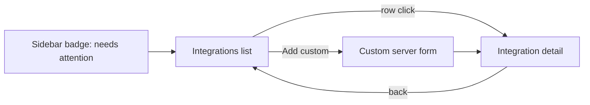

# Integrations screen: competitor teardown and recommendations

Input: six screenshots from two competitor products, taken 2026-11-06.

- **Product A** is a dark desktop app with a full-page "Marketplace" (Apps / Agents / Skills). Screens: catalog, GitHub detail (not connected), Linear detail (connected).
- **Product B** is a light chat app where integrations open in a modal over the conversation. Screens: "Connect Apps" catalog, "Manage plugins and skills", Gmail detail. [INFERENCE] Probably Cursor: the Gmail detail lists Developer "Cursor" and website cursor.com, though no product chrome is visible.

The current claudebot screen is `web/integrations.tsx`: a responsive grid of `IntegrationCard`s. Each card puts everything inline:

- Header: state badge, transport/endpoint, enable switch.
- Error alert.
- Auth forms: DCR button, token form, own-client OAuth steps, and the alternatives behind a disclosure.
- Filterable tool list: per-tool Off/Ask/Auto toggles, `read-only`/`destructive` badges, `Reset to defaults`, and the note "Ask tools are denied in scheduled routines; set Auto on tools a routine needs."
- Skill toggles and `skillsError`.
- Footer:
  - `Refresh tools` / `Retry` / `Reconnect` calls `probe`.
  - `Disconnect` (when connected) deletes the stored secret and keeps tool settings.
  - `Remove` (custom servers only) deletes the tool settings.

The catalog (`src/integrations/catalog.ts`) has 5 entries: Gmail, Linear, GitHub, PostHog, Cloudflare.

## 1. What's in the screenshots

### Product A: catalog (full page)

- Left rail: `Marketplace` → Apps, Agents, Skills. Below it, `Your apps` lists connected apps (Linear) as direct shortcuts.
- Header: "Apps", subtitle "Connect the tools and services that your agents work with."
- Full-width search with a secondary `+ Add custom` button beside it.
- Category sections with counts: `Coding 11`, `Design 3`, `Data & Analytics 3`. Thin dividers between sections.
- Two-column rows: 40px icon, name, one-line capability description ("Repositories, issues and pull requests", "Errors and crash triage"). Long descriptions truncate with an ellipsis.
- Right-aligned action per row: `+ Connect` (ghost button), or `✓ Connected` as plain text with no button.
- Connected apps stay in their category; nothing floats them to the top.

### Product A: detail, not connected (GitHub)

- Header: icon, name, grey `● Not connected` pill, tagline. Primary filled button `Connect GitHub` on the right.
- One "Information" card. It opens with a scope sentence: "Every agent on this computer can use your GitHub repositories, issues and pull requests, and gh and git." Below it, key/value rows: Developer, Category, Website ↗.
- No preview of permissions, tools, or auth method before connecting.

### Product A: detail, connected (Linear)

- Header: green `● Connected` pill and a `Copy link` button (deep link to this page).
- **Hero** on a large gradient: three example prompts, each tagged with an inline `Linear` mention chip and a → button that runs it ("What is assigned to me this week?", "Triage the backlog…", "File an issue for the crash…").
- **Connection**: `+ Add account` on the section header. One account row shows the icon, "Linear", and "Signed in". It does not name the account or workspace.
- **Information**: a description of what agents can do and the per-user sign-in model, then Developer, Category, Version, Website, Privacy Policy, Terms of Service. Links carry ↗.
- **Danger zone**: "Disconnect Linear" with consequence copy ("Remove Linear and its skills from this computer. You can connect it again later.") and a low-emphasis `Disconnect` text button.

### Product B: "Connect Apps" catalog (modal)

- Top right: stacked icons of connected apps plus `10 connected ›`, which leads to the management view.
- Search placeholder "Search across apps and skills". One box searches both apps and skills.
- `Bot templates ↗` sits next to search, cross-linking to templates.
- Category chips: All (selected, filled), Password Managers, Productivity, Communication, Design, Code, `More ▾`.
- `Recommended for you` section with `View all`, then one section per category, each with `View all`.
- Rows: icon and name only, no description. A pill `Connect` button on each row.
- Notion appears in both Recommended and Productivity. The same row repeats on one screen.

### Product B: "Manage plugins and skills"

- Breadcrumb back to `Connect Apps`.
- **Installed**: a two-column grid. Each row shows icon, name, a composition line ("1 connector, 73 skills", "1 connector, 1 skill"), and green `Connected` text. A letter avatar ("T") stands in when there is no icon. `Show all 10 plugins` collapses the overflow.
- **Private skills**: generic doc icon, slug name (`onboarding-connections-v4`), and "From template · <when to use it>", truncated to one line.

### Product B: detail (Gmail)

- Back and close. Header: icon, name, and two equal-weight buttons, `Share` and `Uninstall`.
- One-line description: "Search, read, draft, and manage email."
- **Accounts**: the real identity (`nikolas.barwicki@gmail.com`) with an edit icon and `Connected`. `+ Add Another Account` sits inline.
- **Apps 1**: "gmail · Connector", the MCP server the plugin installs.
- **Information**: Capabilities (1 app), Developer (Cursor, not Google: it names who built the connector), Category (Featured), Website, Availability (Public).

## 2. UX/UI patterns

| Pattern | A | B | Notes |
|---|---|---|---|
| Separate catalog and detail | ✓ page → page | ✓ modal → modal | Both keep configuration off the list. |
| Row anatomy | icon · name · capability line · action | icon · name · action | A's capability line does most of the work when picking. |
| Connected state in list | `✓ Connected` text replaces button | green text in "Installed" | Both are binary. Neither shows a broken or expired state. |
| Connected summary | sidebar "Your apps" | stacked avatars + "10 connected ›" | Both put "what I have" one click away. |
| Grouping | category sections with counts | chips + sections + Recommended | B's duplicates rows across sections. |
| Search | apps only | apps and skills | Unified search matters once skills exist. |
| Custom/BYO server | `+ Add custom` next to search | not shown | |
| Scope statement | "Every agent on this computer can use…" | description line | A says who gets access. B says only what the app does. |
| Account identity | "Signed in" (no identity) | email shown | B is better. A leaves "which account?" unanswered. |
| Multi-account | `+ Add account` | `+ Add Another Account` | Both have it. |
| Composition | "skills" in disconnect copy | "1 connector, 73 skills" | B shows what an install brings. |
| Example prompts | gradient hero with runnable prompts | none | Teaches value after connecting. |
| Provenance metadata | Developer, Version, Privacy, Terms | Developer, Availability | Matters for trust in third-party MCP. |
| Destructive action | Danger zone + consequence copy | `Uninstall` next to `Share` | A is safer. |
| Sharing | Copy link | Share | Multi-user or deep-link feature. |
| Permissions / tool control | none visible | none visible | Neither shows per-tool control. |

## 3. Opinion

**A's information architecture is better; B's catalog has the better shortcuts.** A's full-page catalog with capability lines and the Connection / Information / Danger zone detail is calm, scannable, and safe. From B, take three things: account identity, the composition line ("N tools, M skills"), and unified search over apps and skills.

**Neither product shows what an agent may *do* with a connection.** Both reduce an integration to connected or not connected. Claudebot's per-tool `off/ask/auto` policy is the strongest item on the roadmap (`docs/roadmap.md`: "Ahead of every competitor on safety"). The current UI hides it inside a crowded card. The rebuild should make permissions a headline section of the detail page.

**Neither shows failure.** Both screens assume connecting works once and stays working. Claudebot has four `ConnState`s (`disconnected`, `connected`, `needs-auth`, `failed`) plus `enabled`, and the sidebar already counts integrations needing attention. Expired tokens are a real event here: Gmail in Testing mode expires refresh tokens after seven days (`GMAIL_OAUTH` steps). The list must show broken states as clearly as healthy ones.

**A's hero is marketing.** The gradient pushes connection status and settings below the fold, and three example prompts don't need 400px. Runnable prompts are still a good idea after connecting, as a compact row.

**Categories and chips are premature.** A needs them for ~17 apps and B for ~30+. Claudebot has 5 catalog entries plus custom servers, so sections with one or two rows each would add chrome with no benefit. Add grouping when the catalog passes ~12. The roadmap adds Slack, Notion, Calendar, Drive, and Stripe, which brings it to ~10.

**Connect effort differs a lot per service and nobody says so.** A Linear DCR sign-in is one click. Gmail needs a Google Cloud project, a consent screen, and an own client, about 7 steps. Users should see that before clicking Connect, not after.

**Skip** Share/Copy link (local, single-user app), Version/Privacy/Terms rows (we don't have the data, and a fake row is worse than none), and "Recommended for you" (no signal to recommend from).

## 4. Recommendations

### 4.1 Information architecture



- Split the screen into a **list** and a **detail** view, both inside the existing `Page` shell and the `integrations` view of `app-sidebar.tsx`. Keep it a page, not a modal: integrations are global and configured deliberately, so they don't need a modal over chat.
- The detail view takes everything currently inside `IntegrationCard`. The list carries no forms, switches, or tool lists.

### 4.2 List view

```
Integrations                                                [+ Add custom]
MCP servers and skills shared by every bot. Changes apply on each bot's next turn.
[ Search integrations, tools and skills…                                ]

Your integrations
 (G) Gmail        Read and draft email           ⚠ Needs sign-in   [Sign in]
 (L) Linear       Issues and project triage      ● Connected · 12 tools · 0 skills   ›
 (C) Cloudflare   Workers, DNS, storage, logs    ● Connected · Paused             ›

Available
 (GH) GitHub      Repositories, issues, PRs      Token or own OAuth app   [+ Connect]
 (PH) PostHog     Product analytics and flags    One-click sign-in        [+ Connect]
```

- Two sections, **Your integrations** (catalog entries the user has started or connected, and every custom server) and **Available** (catalog entries not yet set up). No category grouping until the catalog passes ~12.
- Row anatomy follows A: icon, label, one-line capability (new `CatalogEntry.tagline`), and a right-side status or action.
- Sort "Your integrations" by attention first (`failed`, `needs-auth`), then by label. Use the same predicate as `integrationsNeedingAttention` in `main.tsx` so the sidebar badge and the list agree.
- The status area shows all states, not a binary:
  - `connected` → green dot, plus "N tools · M skills" (B's composition line).
  - `connected` with `enabled: false` → "Paused" in muted text.
  - `needs-auth` → warning + inline `Sign in` button. The only inline action in the list, because it's the most common fix.
  - `failed` → error + `View error ›`.
  - Available → effort hint ("One-click sign-in", "API key", "Own OAuth app · ~10 min"), derived from `IntegrationAuth`, plus `+ Connect`.
- Search filters labels, taglines, tool names, and skill names (B's unified search). It matches tools users have already seen.
- `+ Add custom` goes in the page header (A).
- Empty state: drop "No integrations yet". The Available section always has catalog entries, so the screen is never empty.

### 4.3 Detail view

```
‹ Integrations
(L) Linear  ● Connected                                   [Pause] [⋯]
    Issues and project triage
    Every bot can use these tools. Changes apply on each bot's next turn.

Connection
  Signed in with OAuth · mcp.linear.app · checked 2 min ago   [Refresh tools]
  ⚠ error text (only when failed)

Permissions                                         [Reset to defaults]
  Search tools…
  Read      list_issues, get_issue, …                 Auto ▾ (per tool)
  Write     create_issue, update_issue, …             Ask  ▾
  Destructive delete_issue                            Off  ▾

Skills (from github.com/cloudflare/skills)
  [✓] skill-name   description

Try it
  "What is assigned to me this week?" →   (opens chat with prompt prefilled)

Details
  Server  https://mcp.linear.app/mcp · HTTP
  Source  Built-in catalog | Custom

Danger zone
  Disconnect Linear: deletes its secret from the keychain. Tool settings
  are kept, so reconnecting restores them.                    [Disconnect]
  Remove (custom servers only): deletes the server and its tool settings.
                                                                  [Remove]
```

- **Header**: status pill (A), tagline, and a **scope sentence** (A's best idea) that says who gets access. MCP integrations are global today: every bot gets every enabled integration (`integrations.session()` takes no bot). The sentence is therefore "Every bot can use these tools." Per-bot grants exist only for website logins on the Credentials screen. No roadmap item scopes integrations per bot.
- **Primary action by state**: `Connect` / `Sign in` / `Retry` when not connected, `Pause`/`Resume` when connected. Pause maps to `set-enabled`. It differs from disconnecting because credentials stay, and neither competitor offers it.
- **Connection**: auth method, endpoint host, last state change, and the error inline when `failed`. Pre-connect, this section holds the auth flow:
  - DCR → one button.
  - Bearer → token field with "Create a token ↗" (`tokenUrl`).
  - Own client → numbered `OwnClient.steps` as a real stepper with the redirect URL copy button, not a paragraph wall.
  - Alternatives (`auth.alternative`, `bearer.ownClient`) stay behind a disclosure, as `Alternative` does now.
- **Account identity** (from B) needs data we don't have today [INFERENCE: nothing in `IntegrationRecord` stores an account label]. It needs a per-service whoami tool call or token introspection after connect. Worth it for Gmail and GitHub. Ship the screen without it and add a row when the data exists. Don't show A's empty "Signed in" placeholder.
- **Permissions**: this section is the differentiator. Group tools by `readOnly` / `destructive` (the fields already exist on `IntegrationTool`) with the policy control on each row. Keep the search, `Reset to defaults` with its tooltip, and the routine warning ("Ask tools are denied in scheduled routines"). That warning is the one place users learn that Ask blocks unattended runs (roadmap item 1), so it belongs at the top of the section, not in footer text. A group-level "set all" control is a candidate if users ask for it. Leave it out at first.
- **Skills**: the current toggles, plus the source repo (`skillsRepo` / `skillsDir`) and `skillsError` inline.
- **Try it** (A's hero, shrunk): 2–3 example prompts per catalog entry (new `CatalogEntry.examples`). Clicking one opens the current or last bot's chat with the prompt prefilled, not sent. Hide it when the integration isn't connected. Custom servers have no examples, so hide it for them. Lowest priority. Cut it if it slips.
- **Details**: endpoint and transport (the monospace line from the current card header), and Built-in vs Custom. For MCP, where the server lives is the provenance users need. A's Version/Privacy/Terms rows don't apply.
- **Danger zone** (A): keep the two current actions distinct. Neither competitor has this split.
  - `Disconnect` deletes the keychain secret and keeps policies, so reconnecting restores them.
  - `Remove` applies to custom servers only and deletes the server and its settings.

  Each gets consequence copy and goes through the existing `confirmAction`. Don't put them beside a benign button the way B does.

### 4.4 Visual

- Follow A's density: section titles outside cards, one rounded surface per section, muted labels in a left column, values on the right.
- Status colors: reuse `StateBadge` (emerald for connected). Add warning amber for `needs-auth` and destructive for `failed`, matching the sidebar badge's `text-destructive`.
- Icons: catalog entries need a logo field. Custom servers get a letter avatar (B's "T" tile).

### 4.5 Data changes this implies

| Field | Where | Why |
|---|---|---|
| `tagline` | `CatalogEntry` | capability line in list and header |
| `icon` | `CatalogEntry` | row and header logo |
| `examples?: string[]` | `CatalogEntry` | Try it |
| account label | integration record, filled after connect | account identity; optional, later |

No server API changes are needed for the list/detail split. Every existing action (`set-enabled`, `set-policy`, `reset-policies`, `set-skill-enabled`, `connect-oauth`, `set-bearer`, `probe`, `disconnect`, `remove`) moves into the detail view unchanged. The probe action keeps its state-dependent label: `Refresh tools` when connected, `Retry` when failed, `Reconnect` otherwise. Put it in the Connection section header.

### 4.6 Out of scope for this rebuild

- Multi-account per service. Both competitors have it. Here it collides with `integrations.name UNIQUE` as the MCP server name (`src/platform/db.ts`) and needs a naming scheme like `gmail_work`. Decide separately.
- Category chips, Recommended, Share/Copy link.
- Per-bot integration access. It's not on the roadmap. If wanted, reuse the Credentials screen's per-bot grant pattern rather than invent one; this needs `session()` to take a bot id.

## 5. Open decisions

1. Detail as a routed page (back button, deep-linkable from the sidebar badge) or as a side sheet over the list? The recommendation is a page, because the permissions table needs width.
2. Is account identity worth a per-service whoami call now, or later?
3. Does "Try it" ship in the first cut?

## 6. Decisions taken in the rebuild

The screen now lives in `web/integrations/`: `screen.tsx` switches between `list.tsx` and `detail.tsx`, and `model.ts` holds the pure derivations (sections, health, effort hint, tool groups) with tests in `model.test.ts`. `main.tsx` takes the sidebar badge's `needsAttention` predicate from `model.ts`, so the badge and the list order always agree.

1. Detail is a page inside the Integrations view, selected by id in `App` state. There is no URL routing; picking Integrations in the sidebar returns to the list.
2. Account identity ships later. No "Signed in" placeholder.
3. Try it shipped: `CatalogEntry.examples` fill the open (or most recent) bot's composer without sending.
4. Paused shows only for a connected integration. A paused integration that has failed or lost its sign-in still shows that state.
5. Logos are Simple Icons paths (CC0) in `src/integrations/icons.ts`, referenced by `CatalogEntry.icon`. The unused `CatalogEntry.note` was removed.
